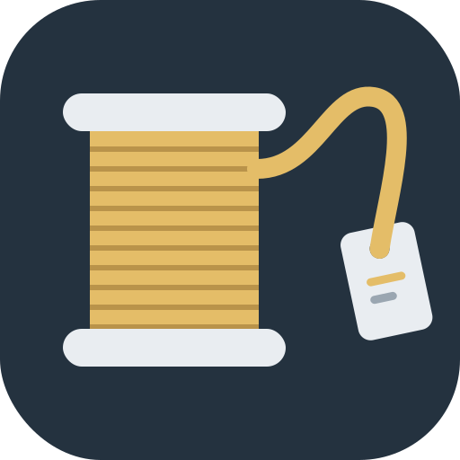

<p align="center"></p>

# bambu-spoolman-bridge

Tracks Bambu Lab filament consumption in [Spoolman](https://github.com/Donkie/Spoolman) automatically.
It listens to Home Assistant ([ha-bambulab](https://github.com/greghesp/ha-bambulab)), works out
which spool each print used and deducts the grams when the print ends. The normal case needs no clicking.

> **Personal project.** Built for and tested on a Bambu Lab P2S with one AMS 2 Pro and an A1
> without AMS (external spool only), with Spoolman 0.27. It may work with other Bambu printers
> that ha-bambulab supports, but there is no support guarantee. Issues and PRs are welcome; answers may be slow.

## How it works

1. **Print start** (`print_status` enters `prepare`/`running`). The bridge presses the printer's
   *force refresh* button if it has one.
   - It then snapshots `print_weight` (grams per source, e.g. `AMS 1 Tray 2` or `External Spool`)
     and resolves each source to a Spoolman spool.
   - At `prepare`, printers still report the previous print's `print_weight` and sometimes its
     `print_progress` of 100. So the snapshot waits until `print_weight` is updated for this print
     (usually with `running`). If it never changes, which happens when you reprint the same file,
     the current value is used after 60 s.
   - The snapshot is stored in SQLite immediately, so swapping spools afterwards or restarting the
     container doesn't break attribution.
   - If `print_weight` is corrected before the print reports any progress, the snapshot is taken again.
2. **During the print** the highest `print_progress` is persisted on every increase. Only progress
   reported after the print started counts, never a value left over from the previous print.
3. **Print end**: `finish` deducts the full slicer estimate per source. For `failed` (error or
   cancel), the deduction depends on how far real printing got:
   - `print_progress` is gcode progress, and the start sequence (heating, bed leveling, calibration,
     purge) is part of the gcode. On small prints it can pass 60–80% before the first layer.
   - So the bridge records the progress at which `current_stage` first becomes `printing` (the
     baseline), and deducts `grams × (max progress − baseline) / (100 − baseline)`.
   - A print that never reached `printing`, or never reported progress, deducts nothing and touches
     no spool.
   - If the bridge restarts mid-print, the baseline is rebuilt from Home Assistant's history.
   - Without a `current_stage` entity, or if the baseline can't be determined, a failed print falls
     back to `grams × max progress / 100`.

   Every deduction goes to `usage_log`, which is the usage history Spoolman itself doesn't keep.

### Finding the spool

- **AMS slot with RFID** (Bambu spools), matched by `tray_uuid`. A Bambu spool has two RFID tags
  with different `tag_uid` but the same `tray_uuid`.
  1. A Spoolman spool with that tag linked (native Spoolman tags, 0.27+).
  2. A spool whose `rfid_uuid` extra field holds it. The tag is then linked too.
  3. First-time pairing of an unbound spool, for example one imported via [intake](#intake). Among
     equivalent spools the opened one wins, otherwise the oldest unopened one (FIFO). Several opened
     spools → you're asked. `rfid_uuid` and the tag are written to it. Tried in this order:
     - same `bambu_filament_id` and exact colour;
     - same Bambu colour code: the RFID's filament id and colour give the code via BambuStudio's table,
       so a filament whose hex came from elsewhere still matches;
     - nearest colour among unbound spools of the same filament id (within `NEAREST_COLOR_MAX_DE`), only
       if exactly one filament qualifies and it has no different colour code. That filament's colour
       is then corrected to what the RFID reports. Two close filaments → you're asked.
  4. Otherwise a new spool is created with `remaining = remain% × tray_weight`. Its filament is reused
     if one exists (by colour code, then filament id + colour), else imported from SpoolmanDB, else
     built from the RFID data. Filaments are never duplicated.
- **Remaining weight of intake spools**: a spool imported without a measured `remaining_weight` counts
  as full. When it's first paired and the AMS estimates it below 95%, the remaining weight becomes
  `remain% × tray_weight`, once. A spool you weighed and imported with its weight keeps it.
- **Pair on insert**: when an RFID spool goes into an AMS slot outside a print, or into a slot the
  running print doesn't use, it's paired right away, with the same steps, and gets its location. No
  deduction.
  - The AMS reads the tag first and its remaining estimate about 10 s later, so pairing waits for both.
  - Each insert logs one line: tray, `tray_uuid`, remain%, the spool and why, and any weight correction.
  - Like all automatic writes, this only logs in DRY_RUN.
  - If the spool can't be paired without guessing, you're asked right away: you're standing at the
    printer. Each `tray_uuid` is asked about once. If a print uses that spool before you answer,
    you're not asked again, and your answer covers both.
- **External spool** (no RFID): matched on the filament selected on the printer screen
  (`filament_id` + color). Exactly one opened spool: use it. No opened spool: open the oldest unopened
  one. If several are opened, or nothing matches, the bridge doesn't guess. A nearest-color fallback
  is used only when it gives a single candidate.
  - Non-Bambu filament works the same way. Selecting e.g. "Generic PETG" on the printer reports
    `GFG99`, which intake stores as the filament's `bambu_filament_id`.
- The spool's location is set to the slot, e.g. `P2S AMS1 Slot 3`, or `A1`.

When a source can't be resolved, you get an **actionable notification** with the two best candidates
and an *Open bridge* button. With `BRIDGE_URL` set, tapping the notification itself also opens the page. The deduction waits until you answer, and the answer survives restarts.
The bridge page is LAN-only, so that link works only on your home network.

## Requirements

- Spoolman **0.27 or newer** (native RFID tags) with these extra fields (Settings → Extra fields):
  - Spool: `rfid_uuid` (text)
  - Filament: `bambu_filament_id` (text, e.g. `GFA00`) and `bambu_color_code` (text)
- Home Assistant with ha-bambulab, a long-lived access token and the Companion app (for notifications).
- Docker (or Node.js 22.9+).

## Configuration

All configuration is environment variables; see [.env.example](.env.example).

| Variable | Required | Default | Meaning |
|---|---|---|---|
| `HA_URL` | yes | | e.g. `http://<home-assistant-host>:8123`. Use an IP in Docker; `.local` names usually don't resolve in containers. |
| `HA_TOKEN` | yes | | Long-lived access token. Never logged (masked as `***`). |
| `SPOOLMAN_URL` | yes | | e.g. `http://<spoolman-host>:7912` |
| `NOTIFY_SERVICE` | yes | | e.g. `notify.mobile_app_<device>` |
| `PRINTERS` | yes | | JSON array, see below |
| `BRIDGE_URL` | no | | Bridge address for the *Open bridge* button, e.g. `http://<bridge-host>:8080` |
| `DRY_RUN` | no | `true` | Anything but `false` keeps Spoolman untouched |
| `LOG_LEVEL` | no | `info` | `debug` also logs the AMS remain% vs. Spoolman gap per spool |
| `TZ` | no | system zone | Log timestamps are local time in this zone with their offset, e.g. `Europe/Zagreb` → `2026-10-14T10:16:44.915+02:00` |
| `PORT` | no | `8080` | HTTP port |
| `DATA_DIR` | no | `/data` | Where `bridge.db` lives |
| `JOB_START_TOLERANCE_SEC` | no | `120` | `start_time` jitter treated as the same print |
| `NEAREST_COLOR_MAX_DE` | no | `20` | Max color distance (CIE76 ΔE) for the nearest-color fallback |
| `SPOOLMAN_RETRY_MINUTES` | no | `5` | Retry interval for deductions that couldn't be written |
| `BAMBU_COLOR_REF` | no | commit `804d93bb5d` | BambuStudio git ref (commit, tag or branch) for the colour code table. Change it to pick up new colours. |
| `TARE_SPOOL_G` | no | | Empty cardboard spool weight for intake (`form: "spool"`) |
| `TARE_REFILL_G` | no | | Weight of the reusable spool a refill goes on (`form: "refill"`) |

`PRINTERS` example:

```json
[
  {"prefix": "<p2s_entity_prefix>", "name": "P2S", "amsLocation": "P2S AMS{unit} Slot {n}", "externalLocation": "P2S External"},
  {"prefix": "<a1_entity_prefix>", "name": "A1", "externalLocation": "A1"}
]
```

`prefix` is the part of the entity IDs between `sensor.` and `_print_status`. `{unit}` is the AMS number
as in HA (`ams_1` = 1) and `{n}` is the slot. Optional per printer: `refreshDelayMs` (default 5000) and
`entities` to override entity IDs (`status`, `progress`, `printWeight`, `startTime`, `taskName`,
`activeTray`, `stage`, `externalSpool`, `refreshButton`).

At startup the bridge logs a table of every entity it found or missed. A printer with missing required
entities (`print_status`, `print_progress`, `print_weight`) is not tracked.

## Intake

`POST /intake` imports spools from order lists into Spoolman, so the inventory is in place before
you switch DRY_RUN off. It's user-initiated and therefore **independent of DRY_RUN**.

```json
{
  "batch_id": "order-2026-10-14",
  "apply": false,
  "items": [
    {"product_line": "PLA Matte", "color_name": "Lilac Purple", "bambu_color_code": "11700", "form": "refill", "count": 2},
    {"bambu_color_code": "10401", "form": "spool", "count": 1, "remaining_weight": 640, "opened": true, "location": "Shelf 2"},
    {"vendor": "Acme", "material": "PETG", "color_name": "Black", "color_hex": "000000", "form": "spool", "count": 1, "price": 18.9, "order_ref": "A-123"}
  ]
}
```

- **`apply: false`** (default) returns the plan and writes nothing: per item the resolved filament id,
  colour code and hex, whether the filament is reused, updated, imported or created, and the spools to
  create.
  - **`apply: true`** writes. If any item needs input, the whole batch is rejected (HTTP 422) and the
    plan lists what's missing.
- **Idempotent**: re-posting a batch returns its spool ids and creates nothing. The same `batch_id`
  with different items is refused (409). If Spoolman fails halfway (502), re-post the same batch: only
  the missing spools are created.
- **Bambu items**: `bambu_color_code` is resolved through BambuStudio's colour table to the filament
  id, product line, English colour name and the hex the RFID reports.
  - A `product_line` that contradicts the code needs your input; a different `color_name` only warns.
  - Codes missing from the table need `product_line`, `color_name` and `color_hex`.
  - Multi-colour filaments get all their colours in `multi_color_hexes`, with `multi_color_direction`
    `longitudinal` for gradients and `coaxial` for multi-part colours (as SpoolmanDB classifies them),
    and an empty `color_hex`, as Spoolman requires. An RFID tray with several colours (`cols`) is
    matched on the whole set.
- **Non-Bambu items**: `vendor`, `material`, `color_name`, `color_hex`.
  - `bambu_filament_id` becomes the generic id the printer reports for that material (Generic PLA =
    GFL99, Generic PETG = GFG99, and so on). Use `profile` for variants such as `"PLA Silk"`.
  - The vendor is reused or created by name.
- **Common optional fields**: `weight` (default 1000), `remaining_weight` (measured; never overwritten
  by the AMS estimate), `opened`, `location`, `price`, `order_ref` (goes into the comment),
  `spool_weight` (overrides the tare).
- **Filaments are resolved local-first**: by colour code, then filament id + colour (or, for non-Bambu,
  vendor + material + colour), then a SpoolmanDB import, then created in SpoolmanDB style (e.g.
  "Matte Lilac Purple", material PLA). `bambu_filament_id`, `bambu_color_code` and `color_hex` are
  always set.

The colour table is BambuStudio's `filaments_color_codes.json`. BambuStudio is AGPL-3.0, so the table
is downloaded at runtime from the pinned `BAMBU_COLOR_REF` and cached in `DATA_DIR`; it isn't part of
this repository. Generic and Bambu filament ids, materials and densities live in
`src/bambu/profiles.js`; `node scripts/verify-profiles.mjs [ref]` re-checks them against BambuStudio.

## DRY_RUN walkthrough

The bridge starts in DRY_RUN. It does everything except write to Spoolman.

1. Start it and check the startup log: the Spoolman version, the extra field check, the entity table
   and `DRY_RUN mode`.
2. Run a print. Expect lines like:
   ```
   [P2S] job 1 started: "Benchy"
   [spoolman] [DRY RUN] would PATCH /spool/1 {"location":"P2S AMS1 Slot 1"}
   [spoolman] [DRY RUN] would POST /spool/1/tag {"uid":"...","format":"bambu"}
   [P2S] job 1 AMS 1 Tray 1 (12.3 g) -> spool #1 [rfid_uuid]
   [executor] [DRY RUN] would deduct 12.3 g from spool #1 (AMS 1 Tray 1, job 1)
   ```
3. Inspect `GET /jobs`, `GET /jobs/<id>` and `GET /usage`. DRY_RUN rows have `write_state: "dry_run"`.
4. Notifications are sent with a `[DRY RUN]` prefix. Tapping a button only logs the answer.
5. When the plan looks right, set `DRY_RUN=false` and restart. DRY_RUN rows are never replayed, so
   nothing from the test period gets deducted afterwards.

Spools created during DRY_RUN appear as `spool #?` because they don't exist yet.

## Deployment

### Docker Compose

```bash
cp .env.example .env
cp docker-compose.example.yml docker-compose.yml
docker compose up -d
```

Images are published to `ghcr.io/vandalpr/bambu-spoolman-bridge` (`latest`, version tags,
`sha-…`) for `linux/amd64` and `linux/arm64`.

### Unraid

- Map `/data` to `/mnt/user/appdata/bambu-spoolman-bridge`.
- Run the container as `99:100` (nobody:users; *Extra Parameters*: `--user 99:100`) so files in
  appdata get the usual ownership. If the directory was created by another user:
  ```bash
  chown -R 99:100 /mnt/user/appdata/bambu-spoolman-bridge
  ```
- Give Home Assistant a fixed IP (DHCP reservation) and use it in `HA_URL`.
- The image has a healthcheck on `/health`.
- Icon URL: `https://raw.githubusercontent.com/vandalpr/bambu-spoolman-bridge/main/assets/icon.png`

## HTTP API (LAN only, no authentication)

| Method | Path | |
|---|---|---|
| GET | `/health` | HA connection, DRY_RUN, tracked printers, active jobs, open pending count |
| GET | `/jobs?limit=50` | Recent jobs |
| GET | `/jobs/:id` | Job with its sources (resolution decisions) and usage rows |
| GET | `/usage?limit=100` | Usage history |
| GET | `/usage/:id` | Page for one deduction; a rejected one can be re-queued or skipped there |
| POST | `/intake` | Import spools from an order list, see [Intake](#intake) |
| POST | `/usage/:id/requeue` | Only for `needs_attention` rows: `{"spoolId": 12}` (same or another spool) or `{"skip": true}` |
| GET | `/pending?state=open` | Pending sources |
| GET | `/pending/:id` | Page to pick the spool (linked from notifications) |
| POST | `/pending/:id/resolve` | `{"spoolId": 12}` or `{"skip": true}` |

Don't expose this port to the internet.

## Reliability

- A job is identified by printer + `start_time` (±2 min). Each source is deducted at most once
  (`UNIQUE(job_id, source_key)`), across restarts, reconnects and repeated status events.
- `pause`, `offline` and HA restarts neither start nor end a job. A stale `running` reported right
  after a finish doesn't start a second job.
- The bridge can restart at any time:
  - an open job whose print has already ended is closed with the persisted max progress;
  - a print that is already running is adopted.
- Before each deduction, the spool's `remaining_weight` is stored with the usage row. If the bridge
  stops mid-write, the next run compares the current weight:
  - lower by exactly the grams: marked applied;
  - unchanged: re-applied;
  - anything else: flagged `uncertain` and you get a notification.
- Spoolman errors:
  - **4xx** (e.g. the spool was deleted): the deduction becomes `needs_attention` and is not retried.
    You get one notification naming the spool, job and grams. Re-queue it to the same or another
    spool, or skip it, on `/usage/<id>`.
  - **5xx, network errors, timeouts**: retried every `SPOOLMAN_RETRY_MINUTES`. After 12 failed
    attempts (about an hour) you get one notification, and retries continue.
  - Only a network error or timeout *during* the deduction call leaves it unclear whether it landed.
    That case goes through the weight comparison above.

## Known limitations

- **AMS auto-refill**: when a spool runs out and the AMS continues from an identical spool in another
  slot, `print_weight` still credits the original slot. All usage goes to the spool from the start
  snapshot. A warning is logged when the active tray is a slot that isn't in the snapshot.
- **No force refresh without Developer LAN mode**: ha-bambulab exposes no buttons then. The bridge
  just waits and reads. If the external spool data is stale, it won't match and you'll be asked.
- Grams are the slicer estimate, not measured.

## Development

```bash
npm ci --ignore-scripts
npm test
npm start
```

`npm start` reads `.env`. Tests use fixtures captured from a real setup, with IDs anonymized.

## License

[MIT](LICENSE)
